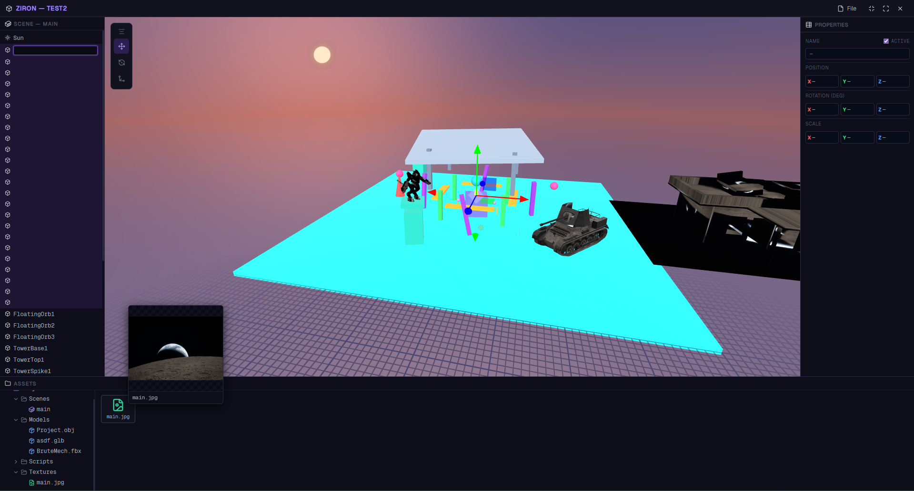

<p align="center">
  
</p>

<h1 align="center">ZIRON Studio</h1>

<p align="center">
  <strong>A lightweight desktop editor for 3D scene prototyping.</strong><br>
  Built with Tauri, Rust, Three.js, and Vite.
</p>

<p align="center">
  <a href="https://github.com/superstrellaa/ziron/releases">Download</a> ·
  <a href="release-notes.md">Release notes</a> ·
  <a href="CREDITS">Third-party credits</a>
</p>

<p align="center">
  
</p>

## About

ZIRON Studio is a focused desktop tool for creating 3D scenes, exploring
compositions, and iterating on visual prototypes. It is an editor for scene
prototyping, not a complete game engine.

## Features

- Real-time 3D viewport with an infinite grid, procedural sky, and directional
  sunlight.
- Fly-camera controls and built-in cube, sphere, cylinder, capsule, plane, and
  cone primitives.
- Camera entities with a live preview and 3840 × 2160 PNG render capture.
- Scene hierarchy, single and multi-selection, and box selection.
- Translate, rotate, and scale tools, including multi-object transforms.
- Properties inspector, undo and redo, and copy, paste, duplicate, and delete.
- Projects and serialized scenes, recent projects, version checks, and
  protection against closing with unsaved changes.
- Asset browser with model and texture imports, previews, and drag-and-drop.
  Supported models: FBX, OBJ, glTF, and GLB. Supported textures: PNG, JPG,
  JPEG, and WebP.
- Configurable keyboard shortcuts, optional automatic saving, and English and
  Spanish localization.

See [Early Access v0.1.0 release notes](release-notes.md) for this first
release's scope.

## Development

### Requirements

- Node.js **20.19+** or **22.12+** (required by Vite 8).
- Rust and Cargo via [rustup](https://rustup.rs/).
- The native development dependencies for your operating system, as listed in
  the [Tauri prerequisites](https://v2.tauri.app/start/prerequisites/).

### Run locally

```bash
git clone https://github.com/superstrellaa/ziron.git
cd ziron
npm install
npm run tauri dev
```

To build a release package for the current operating system:

```bash
npm run tauri build
```

The Tauri configuration enables all bundle formats supported by the build
host. Builds are platform-native: build Windows packages on Windows, macOS
packages on macOS, and Linux packages on Linux. macOS packages intended for
distribution may additionally require signing and notarization.

The release workflow builds Windows and Linux packages, plus macOS packages for
Apple Silicon and Intel.

## Default controls

| Input | Action |
| --- | --- |
| `W`, `A`, `S`, `D` | Move the fly camera |
| Right-click drag | Look around |
| Left-click | Select |
| Shift / Ctrl + left-click | Add to selection |
| Left-click drag | Box-select |
| Right-click | Open the scene context menu |
| `W` / `E` / `R` | Translate / rotate / scale |
| `F2` | Rename selected entity |
| `Ctrl + D` | Duplicate |
| `Ctrl + C` / `Ctrl + V` | Copy / paste |
| `Delete` | Delete selection |
| `Ctrl + Z` / `Ctrl + Y` | Undo / redo |
| `Ctrl + S` | Save scene |

Keyboard shortcuts can be changed in the editor settings.

## Credits and license

ZIRON Studio is distributed under the [MIT License](LICENSE). See [CREDITS](CREDITS)
for direct dependency and asset attributions.
